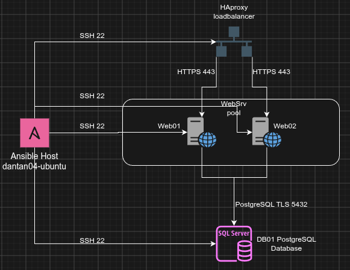
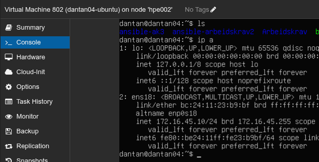
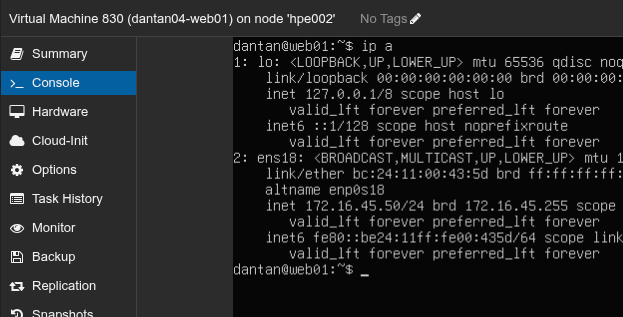
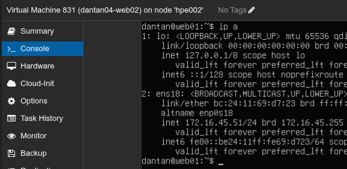
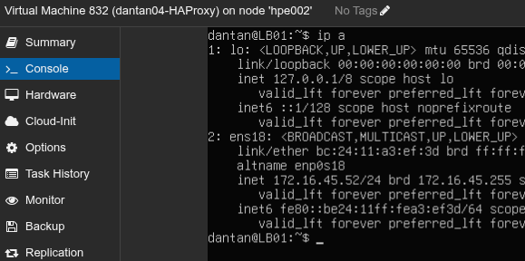
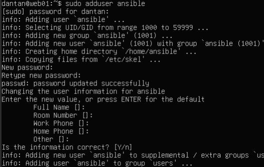
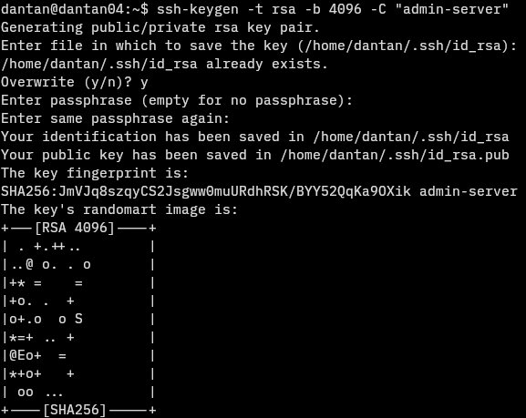

# Arbeidskrav 3 Linux serverdrift -- Tjenestemiljø

NOTE: Testet ansible oppsett med ping playbook. Alle OK.
- **Neste:** Sett opp LB med HAProxy i multipass miljø for å finne ut av hvordan det virker.
- Opprett playbook for HAProxy vm.

## Planlagt oppsett



Ansible host/administrasjonsserver kjører på ubuntu host dantan04-ubuntu (VMid: 802, IP addr: 172.16.45.10), og administrerer 4 servere:
- HAproxy (LB (HAProxy), Distro: Ubuntu)
- web01 (web server (NGINX + PHP), Distro: Ubuntu)
- web02 (web server (NGINX + PHP), Distro: Ubuntu)
- DB01 (DB (PostgreSQL), Distro: Ubuntu)

## Administrasionsserver



Bruker fortsatt VM dantan04-ubuntu (ID: 802, ip addr: 172.16.45.10) som ansible host, samme som AK2. \
Brukernavn: dantan \
Passord: Passord123 \
IP addr: 172.16.45.10  -- Kanskje flytte bak pfsense?

Ansible root dir for dette arbeidskravet: /home/dantan/ansible-ak3

Husk å legge til litt om grunn oppsett til ansible (Hent fra da jeg satt opp i ak2)

## Web01



web01 server -- ene web serverene i webserver cluster.

Brukernavn: dantan \
Passord: Passord123 \
IP addr: 172.16.45.50 -- Kanskje flytte bak pfsense?

Web server stack (installeres, konfigureres, og styres av ansible via administrasjonsserver)
- PHP
- NGINX


## Web02



(Klonet web01 etter ubuntuinstallasjon, så hostname står som web01 i bildet over. Men er nå endret til web02)
web02 server -- ene web serverene i webserver cluster.

Brukernavn: dantan \
Passord: Passord123 \
IP addr: 172.16.45.51 -- Kanskje flytte bak pfsense?

Web server stack (installeres, konfigureres, og styres av ansible via administrasjonsserver)
- PHP
- NGINX

## LB01




Brukernavn: dantan \
Passord: Passord123 \
IP addr: 172.16.45.52 -- Kanskje flytte bak pfsense?

Tjenester -- (installeres, konfigureres, og styres av ansible via administrasjonsserver)
- HAProxy

## DB01


Brukernavn: dantan \
Passord: dantan \
IP addr: 172.16.45.53 -- Kanskje flytte bak pfsense?

Tjenester -- (installeres, konfigureres, og styres av ansible via administrasjonsserver)
- PostgreSQL

## Sette opp dedikert ansible bruker på target servere (gjentas på alle servere, unntatt administrasjonsserver)

TODO: Sette opp ansible bruker på alle ansible klientene:
- [X] web01
- [X] web02
- [X] db01
- [X] lb01

### Opprette ansible bruker



Brukernavn: ansible \
Passord: Passord123

### Gi sudo tilgang uten passord 
- Kjører sudo visudo
- Legger til ```ansible ALL=(ALL) NOPASSWD: ALL``` i text filen som kommer opp

Tester at dette virker ved å bytte til ansible brukeren, og kjøre ```sudo whoami```   


Får kjørt sudo kommandoer uten passord. Alt ok!

### Passwordless login

Setter opp passwordless login, med RSA key, for å forhindre uautorisert innlogging ved passordlekkasje.



Kjører ```ssh-keygen -t rsa -b 4096 -C "admin-server"``` for å generere rsa key pair. Dette blir lastet opp til alle de andre serverene som skal bli administrert av ansible.

Laster opp key til alle servere samtidig med følgende kommando:

 ```
    *Push the key to all 4 servers in one go*
    for server in server1_ip server2_ip server3_ip server4_ip; do
        ssh-copy-id user@$server
    done

```

TODO: Deaktiver passord autentisering med følgende kommandoer (Kanskje ikke gjøre?:

```
for server in server1_ip server2_ip server3_ip server4_ip; do
    echo "Configuring $server..."
    ssh user@$server "sudo sed -i 's/^#\?PasswordAuthentication.*/PasswordAuthentication no/' /etc/ssh/sshd_config && sudo systemctl restart sshd"
done
```
